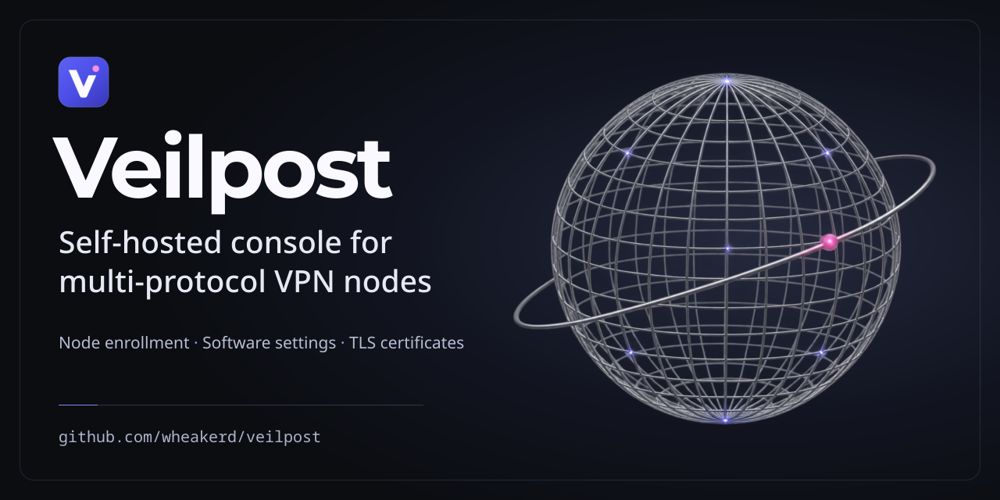

<div align="center">

#  **Veilpost**

English | [简体中文](README.zh-CN.md)

---

**A self-hosted console for multi-protocol VPN nodes.**

[](https://github.com/wheakerd/veilpost/actions/workflows/ci.yml)
[](https://github.com/wheakerd/veilpost/releases)
[](https://github.com/wheakerd/veilpost/issues)
[](https://github.com/wheakerd/veilpost/pulls)

[Quick start](#quick-start) ·
[Console workflows](#console-workflows) ·
[Development stack](#run-and-maintain-the-development-stack) ·
[Develop and package](#develop-and-package) ·
[Documentation](#documentation)



</div>

## Quick start

Install the release packages directly on a Linux host. [Host installation](docs/releasing.md#install-on-a-linux-host)

For local Compose development, you'll need Git, Docker with the Compose plugin, GNU Make, and Python 3.11 or newer.

```bash
git clone https://github.com/wheakerd/veilpost.git
cd veilpost
make start
make admin-create
```

`make start` builds the frontend and backend and waits for both services to be ready. Enter a username and password at the `make admin-create` prompts, then sign in at the default address, <http://127.0.0.1:3000>.

To generate a random password, run `make admin-create GENERATE_PASSWORD=1 USERNAME=admin`. The command displays the credentials file path under `.runtime/admin-credentials/` by default. Save the password in your password manager and delete the file.

## Console workflows

### Enroll a VPN node

Open the console at an address the node can reach, using HTTPS for remote nodes. In **VPN nodes**, create an entry and run the displayed enrollment command on the node host. Enter the one-time token when prompted, then run `veilpost-agent run`. The node list shows its online status, last contact time, and agent version.

For an online node that has opted in, use **Install Docker** to choose a package source and track the installation. [Prepare node package sources](app/agent/README.md#docker-engine-on-node-hosts)

### Configure VPN software

In **Store**, enable Xray-core, Hysteria 2, or AmneziaWG from the built-in catalog. Open the app's page to edit and save its settings in the console.

### Request a TLS certificate

Add credentials in **DNS providers** that can manage records for your domains. Supported providers are Cloudflare, Alibaba Cloud DNS, Tencent Cloud DNSPod, and AWS Route 53.

In **Certificates**, enter the domains, select the credentials, and submit the request. Veilpost validates domains with ACME DNS-01 and renews certificates automatically. It uses Let's Encrypt by default and supports custom ACME directories.

### Set up your account and interface

In **Account security**, enable TOTP two-step verification and save your recovery codes. In **Preferences**, choose a theme, vision mode, or interface language. Veilpost follows your browser's language by default and supports 简体中文, English, 繁體中文, and Русский.

## Run and maintain the development stack

| Task                                      | Command        |
| ----------------------------------------- | -------------- |
| Show service status and the current URL   | `make status`  |
| View frontend and backend logs            | `make logs`    |
| Rebuild and restart after backend changes | `make restart` |
| Stop the stack                            | `make stop`    |

Frontend changes appear through hot module replacement. Run `FRONTEND_PORT=0 make start` to let Docker choose a host port. To open the browser manually, start with `OPEN_BROWSER=false make start`.

Compose stores backend data in the `auth-data` volume. Stop the stack before backing up the entire volume, including `auth.sqlite` and `master.key`.

### Recover administrator access

- Reset a forgotten password with `make admin-reset-password USERNAME=admin`.
- If you lose the authenticator and recovery codes, turn off two-step verification with `make admin-reset-two-factor USERNAME=admin`.

Replace `admin` with the account's username. Both commands revoke the account's existing sessions.

## Develop and package

Local checks use the repository's pinned Go, Node, and Bun versions and a C compiler. Install dependencies and Playwright Chromium, then run the checks.

```bash
make install
(cd app/frontend && bunx playwright install chromium)
make check
```

To run the browser tests with an installed Chrome, use `PLAYWRIGHT_CHANNEL=chrome make check`.

After installing dependencies, use `make native-start` and `make native-stop` for native debugging. Native mode uses a separate data directory. Stop the current stack before switching modes to free the default frontend port, 3000.

Run `make build` to generate the frontend assets and the `veilpost-api` and `veilpost-agent` binaries. `make release VERSION=v0.1.0` creates versioned archives and checksums in `dist/releases/v0.1.0/`, with Linux `amd64` and `arm64` builds for the API server and the node agent. Pushing a version tag triggers the GitHub Actions release workflow, which runs CI before publishing the archives.

## Documentation

| Topic                                   | Guides                                                                                                                                                                                                          |
| --------------------------------------- | --------------------------------------------------------------------------------------------------------------------------------------------------------------------------------------------------------------- |
| Console, API server, and node agent     | [Frontend](app/frontend/README.md) · [Backend configuration and data](app/backend/README.md) · [Agent usage](app/agent/README.md)                                                                               |
| Toolchains, deployment packages, and CI | [Development and releases](docs/releasing.md)                                                                                                                                                                   |
| Feature design                          | [Node enrollment and control channel](docs/nodes-design.md) · [Store, certificates, and localization](docs/platform-design.md)                                                                                  |
| HTTP API contracts                      | [Authentication](app/frontend/docs/auth-api.md) · [Nodes and agent](app/frontend/docs/nodes-api.md) · [Store](app/frontend/docs/apps-api.md) · [Certificates and DNS providers](app/frontend/docs/certs-api.md) |
| VPN deployment references               | [Soft-router configurations](docker/soft-router/README.md) · [AmneziaWG node image](docker/node/amneziawg/README.md)                                                                                            |
