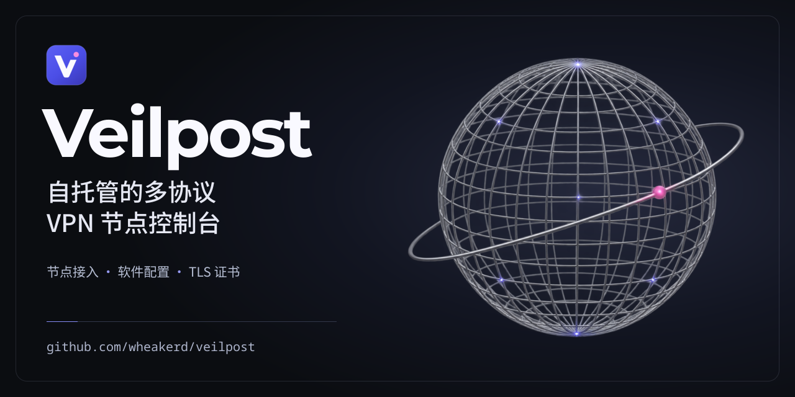

<div align="center">

#  **Veilpost**

[English](README.md) | 简体中文

---

**自托管的多协议 VPN 节点控制台。**

[](https://github.com/wheakerd/veilpost/actions/workflows/ci.yml)
[](https://github.com/wheakerd/veilpost/releases)
[](https://github.com/wheakerd/veilpost/issues)
[](https://github.com/wheakerd/veilpost/pulls)

[快速开始](#快速开始) ·
[使用控制台](#使用控制台) ·
[运行与维护开发环境](#运行与维护开发环境) ·
[开发与打包](#开发与打包) ·
[文档索引](#文档索引)



</div>

## 快速开始

准备 Git、Docker（含 Compose 插件）、GNU Make 和 Python 3.11 或更高版本。

```bash
git clone https://github.com/wheakerd/veilpost.git
cd veilpost
make start
make admin-create
```

`make start` 构建前后端并等待服务就绪。按 `make admin-create` 的提示输入用户名和密码，再打开默认地址 <http://127.0.0.1:3000> 登录。

需要生成随机密码时，运行 `make admin-create GENERATE_PASSWORD=1 USERNAME=admin`。命令会显示凭据文件的位置，默认保存在 `.runtime/admin-credentials/` 下。将密码存入密码管理器后删除该文件。

## 使用控制台

### 接入 VPN 节点

从节点可访问的地址打开控制台，接入远程节点时使用 HTTPS。在 **VPN 节点** 中创建节点，再到节点主机运行界面给出的注册命令。按提示输入一次性令牌，然后运行 `veilpost-agent run`。节点列表会显示在线状态、最后通信时间和代理程序版本。

### 配置 VPN 软件

在 **软件商店** 的内置目录中启用 Xray-core、Hysteria 2 或 AmneziaWG，再打开对应的软件页面，在控制台编辑并保存设置。

### 申请 TLS 证书

在 **DNS 服务商** 中添加可以管理目标域名解析记录的凭据。支持 Cloudflare、阿里云 DNS、腾讯云 DNSPod 和 AWS Route 53。

在 **证书** 中填写域名，选择凭据并提交申请。Veilpost 使用 ACME DNS-01 验证域名，并自动续期证书。默认使用 Let's Encrypt，也支持自定义 ACME 目录。

### 设置账号和界面

在 **账号安全** 中启用 TOTP 两步验证并保存恢复码。在 **偏好设置** 中选择主题、视觉模式或界面语言。界面默认跟随浏览器语言，支持简体中文、English、繁體中文和 Русский。

## 运行与维护开发环境

| 操作                       | 命令           |
| -------------------------- | -------------- |
| 查看服务状态和实际访问地址 | `make status`  |
| 查看前后端日志             | `make logs`    |
| 修改后端后重新构建并启动   | `make restart` |
| 停止开发环境               | `make stop`    |

前端修改通过热更新生效。运行 `FRONTEND_PORT=0 make start` 可让 Docker 分配宿主机端口。需要手动打开浏览器时，用 `OPEN_BROWSER=false make start` 启动。

Compose 将后端数据保存在 `auth-data` 卷中。先停止服务，再备份整个卷，一并保存 `auth.sqlite` 和 `master.key`。

### 恢复管理员登录

- 忘记密码时，运行 `make admin-reset-password USERNAME=admin`。
- 验证器和恢复码均遗失时，运行 `make admin-reset-two-factor USERNAME=admin` 关闭两步验证。

将 `admin` 替换为要恢复的账号名。两种操作都会撤销该账号的现有会话。

## 开发与打包

本地检查需要仓库指定版本的 Go、Node、Bun，以及 C 编译器。安装依赖和 Playwright Chromium 后运行检查。

```bash
make install
(cd app/frontend && bunx playwright install chromium)
make check
```

要用已安装的 Chrome 运行浏览器测试，可执行 `PLAYWRIGHT_CHANNEL=chrome make check`。

安装依赖后，可用 `make native-start` 和 `make native-stop` 启停原生调试环境。原生模式使用独立的数据目录。切换模式前先停止当前环境，释放前端默认端口 3000。

运行 `make build` 生成前端静态文件以及 `veilpost-api` 和 `veilpost-agent` 二进制文件。`make release VERSION=v0.1.0` 在 `dist/releases/v0.1.0/` 中生成版本归档与校验和，后端和节点代理分别提供 Linux `amd64` 和 `arm64` 构建。推送版本标签会触发 GitHub Actions 发布工作流，CI 通过后发布这些归档。

## 文档索引

| 主题                         | 指南                                                                                                                                                                                                           |
| ---------------------------- | -------------------------------------------------------------------------------------------------------------------------------------------------------------------------------------------------------------- |
| 控制台、API 服务端与节点代理 | [前端](app/frontend/README.zh-CN.md) · [后端配置与数据](app/backend/README.zh-CN.md) · [代理使用](app/agent/README.zh-CN.md)                                                                                   |
| 工具链、部署包与 CI          | [开发与发布](docs/releasing.zh-CN.md)                                                                                                                                                                          |
| 功能设计                     | [节点注册与控制通道](docs/nodes-design.zh-CN.md) · [软件商店、证书与本地化](docs/platform-design.zh-CN.md)                                                                                                     |
| HTTP API 契约                | [认证](app/frontend/docs/auth-api.zh-CN.md) · [节点与代理](app/frontend/docs/nodes-api.zh-CN.md) · [软件商店](app/frontend/docs/apps-api.zh-CN.md) · [证书与 DNS 服务商](app/frontend/docs/certs-api.zh-CN.md) |
| VPN 部署参考                 | [软路由配置](docker/soft-router/README.zh-CN.md) · [AmneziaWG 节点镜像](docker/node/amneziawg/README.zh-CN.md)                                                                                                 |
